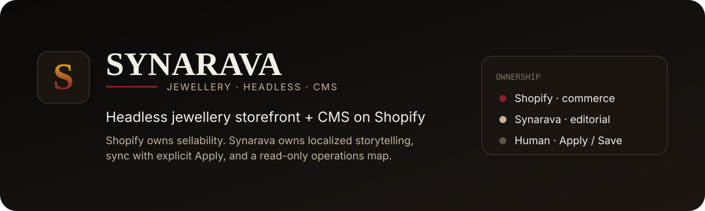
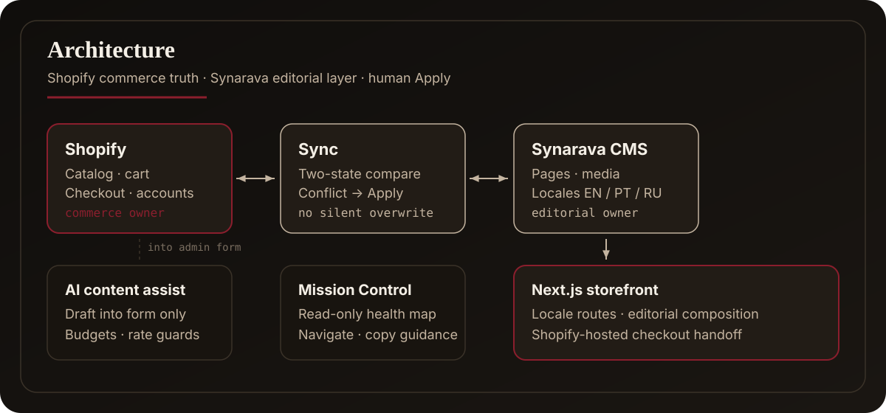
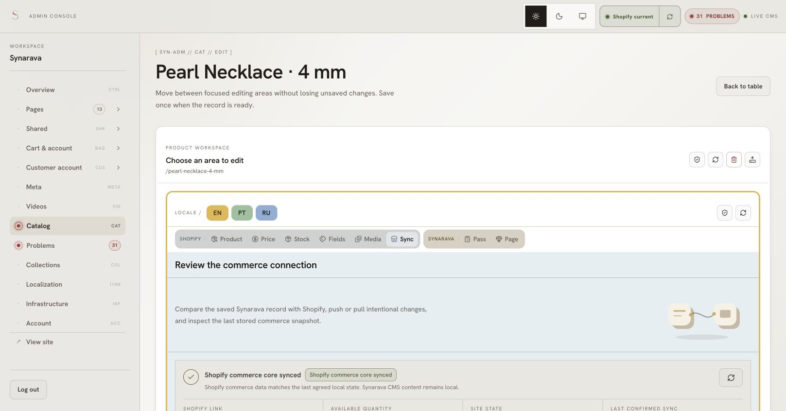

# Synarava

  

**Headless jewellery storefront + CMS on Shopify** — commerce stays with Shopify; Synarava owns the editorial layer, locale-aware admin, sync with explicit human Apply, AI draft assist with budgets and guards, and a read-only Mission Control map.

  

---

## What this repository demonstrates

| Capability | What you can inspect |
| --- | --- |
| **Shopify-owned commerce** | Cart, checkout, customer accounts, and catalog identity stay on Shopify ([ADR-0001](docs/adr/0001-shopify-hybrid-commerce.md), [ADR-0002](docs/adr/0002-shopify-catalog-ownership.md)). |
| **Synarava editorial layer** | Pages, media, product storytelling, and storefront composition without a parallel order store ([PRODUCT.md](PRODUCT.md), [product data ownership](docs/wiki/product-data-ownership.md)). |
| **Locale-aware admin CMS** | EN / PT / RU registry, locale tabs, and synarava-cms field chrome ([synarava-cms](docs/wiki/synarava-cms.md), [ADR-0007](docs/adr/0007-languages-as-data.md)). |
| **Sync / conflict model** | Two-state compare, deep-diff windows, human **Take Shopify** / **Keep ours** — nothing automatic writes Synarava content ([commerce sync](docs/wiki/commerce-sync.md), [ADR-0008](docs/adr/0008-sync-two-state-owner-model.md), [ADR-0009](docs/adr/0009-derive-synarava-commerce-state.md)). |
| **AI-assisted content** | Draft into the product form only; monthly budget, rate limits, and kill-switch; persist only on human Save ([ADR-0011](docs/adr/0011-ai-draft-into-form.md)). |
| **Mission Control** | Read-only architecture / health map on `@synarava/*` widgets — navigate and copy guidance, never mutate systems ([ADR-0005](docs/adr/0005-mission-control-hub.md), [ADR-0006](docs/adr/0006-architecture-map.md)). |

---

## Architecture

---

## Admin sync surface

Shopify skeleton tabs and Synarava editorial tabs in one product editor — compare, push, pull, and inspect the stored commerce snapshot without inventing a second catalog.

---

## Stack

- **App** — Next.js (App Router), React, TypeScript, pnpm
- **UI** — Tailwind CSS, synarava-cms admin primitives, Storybook
- **Data** — Prisma, PostgreSQL, S3-compatible media
- **Commerce** — Shopify Storefront API, Admin GraphQL, Customer Account, hosted checkout
- **Ops surface** — Mission Control (`@xyflow/react` map), Vitest + Playwright coverage

Documentation map: [docs/README.md](docs/README.md).

---

## Development

Local setup, environment configuration, Shopify connection, and deploy notes live in **[docs/DEVELOPMENT.md](docs/DEVELOPMENT.md)**.

---

## Further reading

- [PRODUCT.md](PRODUCT.md) — product purpose and ownership boundaries
- [docs/README.md](docs/README.md) — documentation map
- [docs/DEVELOPMENT.md](docs/DEVELOPMENT.md) — local development
